

  <h1>My Little Youtuber · 나작유</h1>
  
하루의 행동을 계획해 나만의 유튜버를 키우는 육성 시뮬레이션

  

    <a href="https://youtu.be/q5gqqgeEDjw">구현 포트폴리오</a> ·
    <a href="https://youtu.be/AJXVIvXP3EU">게임 트레일러</a> ·
    <a href="https://github.com/csk9914/MyLittleYoutuber">GitHub 저장소</a>
  

[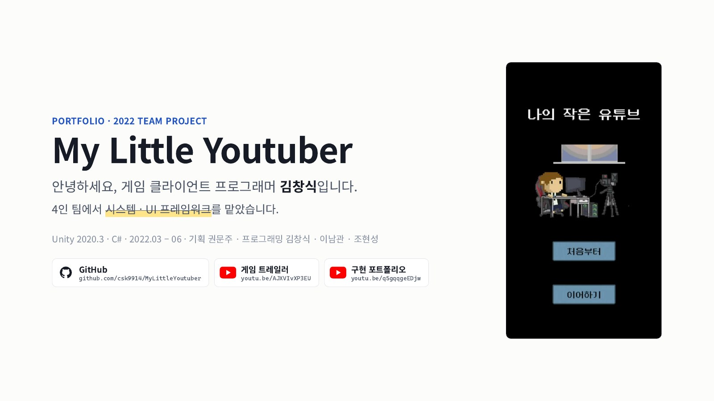](docs/portfolio/page-01.jpg)

## 프로젝트 한눈에 보기

방송으로 영상을 만들고 편집·업로드로 수익과 구독자를 늘려갑니다. 하루를 행동 단위로 운영하며 D+365의 구독자 수에 따라 엔딩이 결정됩니다.

| 항목 | 내용 |
|---|---|
| 개발 기간 | 2022.03 – 2022.06 |
| 팀 구성 | 4명 (기획 1명, 프로그래밍 3명) |
| 엔진 / 언어 | Unity 2020.3 / C# |
| 담당 | 게임 시스템 · UI 프레임워크 |

## 담당 역할과 주요 기여

공통 시스템과 UI 기반을 설계하고, 방송·영상 파트의 팀원 시스템이 연결되도록 데이터 흐름과 인터페이스를 구현했습니다.

| Plastic SCM 이력 기준 | 기여 |
|---|---:|
| 전체 261개 커밋 중 담당 커밋 | 144개 (55%) |
| 직접 작성한 스크립트 | 116개 |
| 팀원 담당 코드 통합·수정 | 41개 파일 |

- **상점 프레임워크:** 콘텐츠·가구·편집자 고용·FLEX 상점을 `BaseUI`와 목록·정렬 팩토리로 통합했습니다.
- **행동 상태머신:** 휴식·수면·방송·편집·미용·운동을 상태로 분리하고 날짜·소모품·주급·엔딩은 `GlobalState`로 관리했습니다.
- **UI 기반:** `PopupBuilder`로 공용 팝업을 만들고 Observer 갱신으로 HUD와 목록이 데이터 변경을 반영하도록 구성했습니다.
- **데이터와 시스템 연결:** 프리팹 기획 데이터와 CSV 진행 데이터를 나누고, 영상 편집·콘텐츠 인기도를 팀원 시스템과 연동했습니다.

## 포트폴리오 페이지 · 18쪽

PDF 페이지를 이미지로 포함했습니다. GitHub에서 아래로 스크롤해 그대로 읽고, 이미지를 클릭하면 큰 크기로 볼 수 있습니다.

[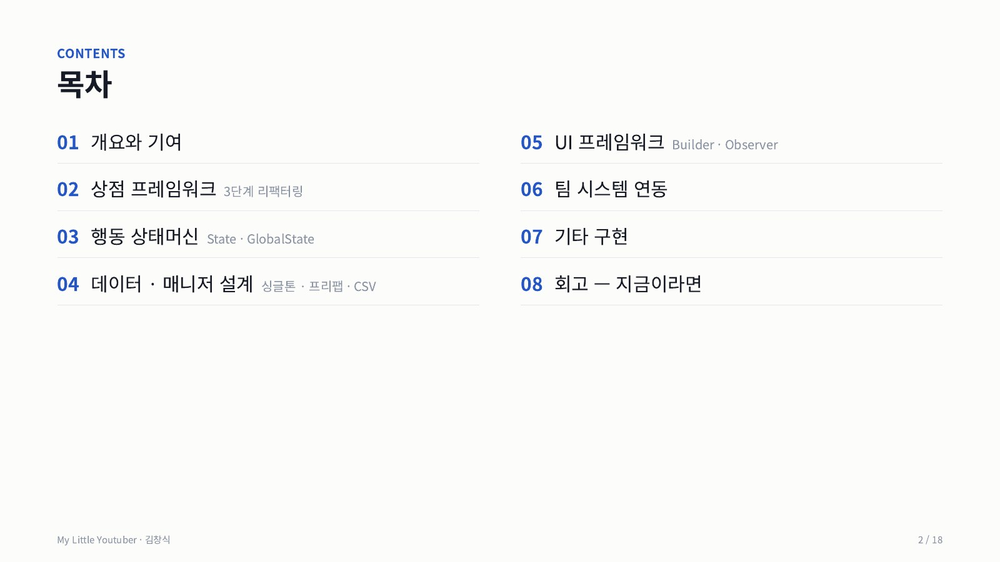](docs/portfolio/page-02.jpg)

[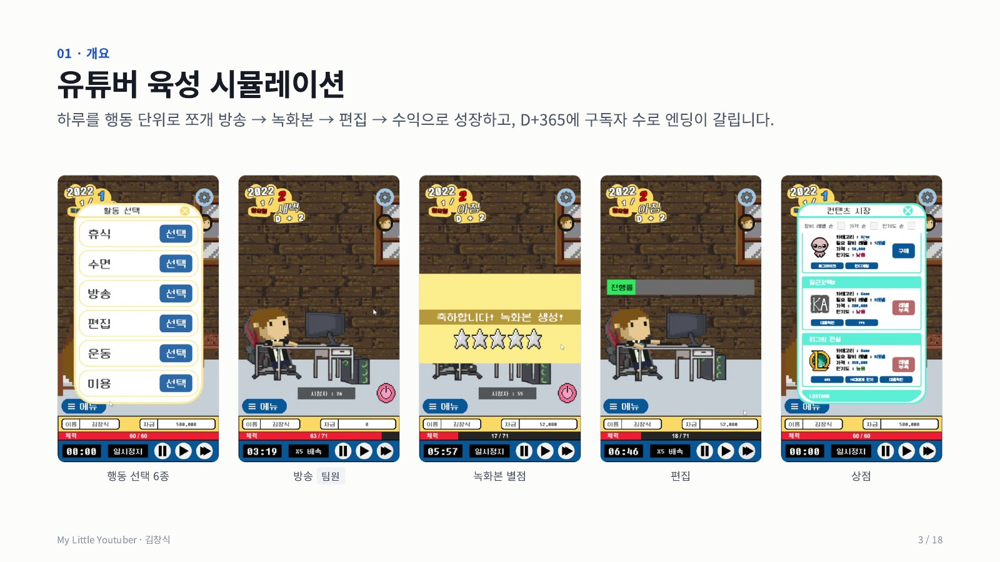](docs/portfolio/page-03.jpg)

[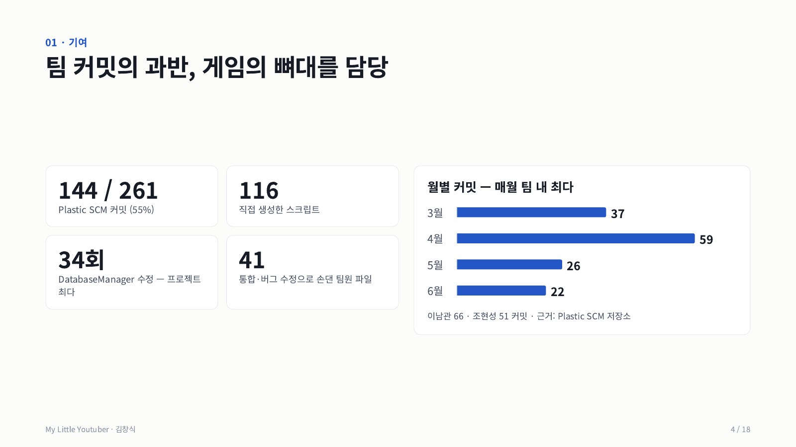](docs/portfolio/page-04.jpg)

[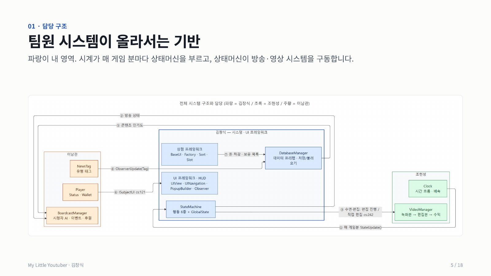](docs/portfolio/page-05.jpg)

[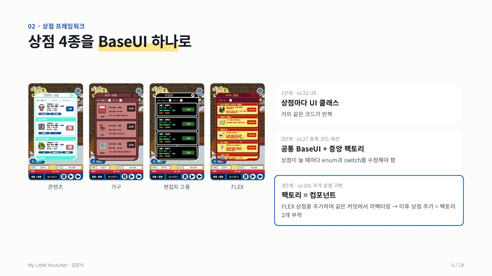](docs/portfolio/page-06.jpg)

[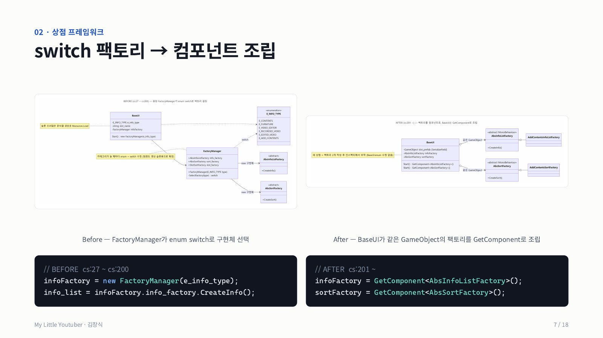](docs/portfolio/page-07.jpg)

[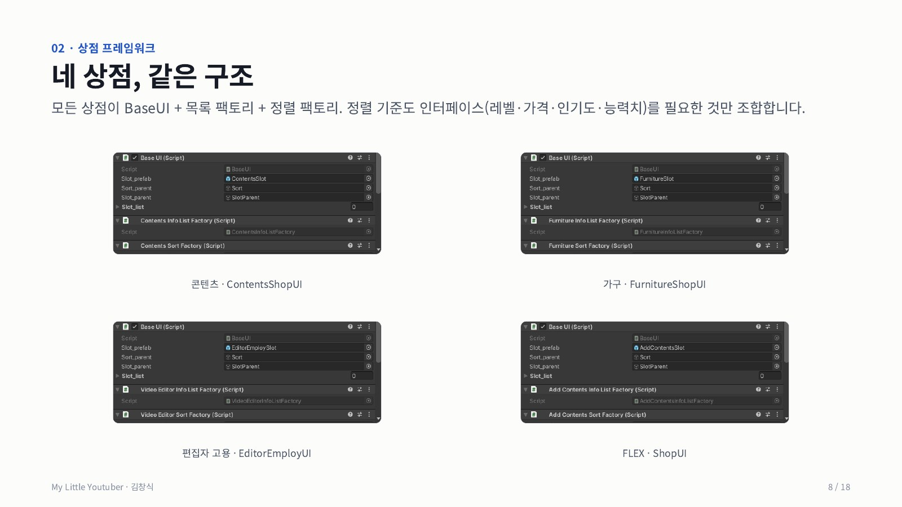](docs/portfolio/page-08.jpg)

[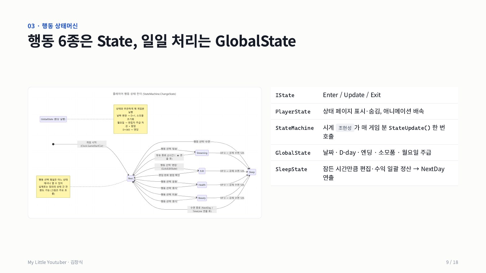](docs/portfolio/page-09.jpg)

[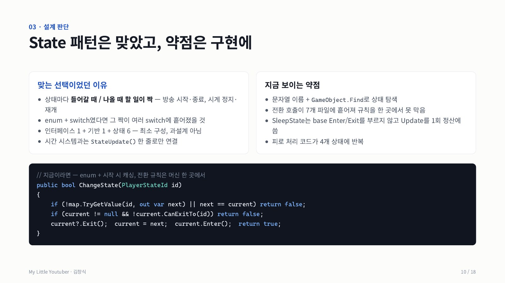](docs/portfolio/page-10.jpg)

[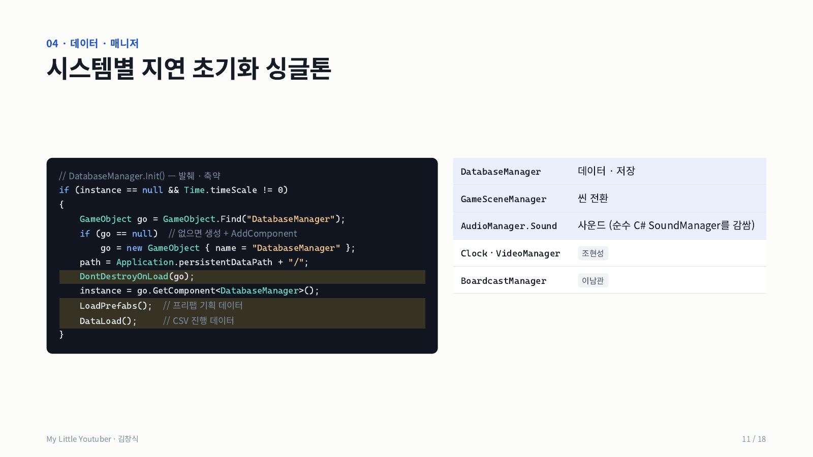](docs/portfolio/page-11.jpg)

[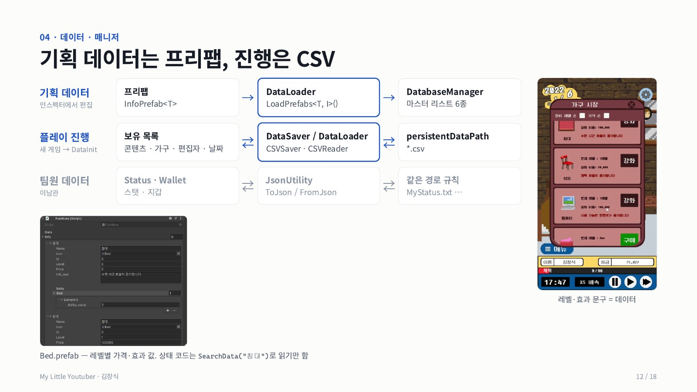](docs/portfolio/page-12.jpg)

[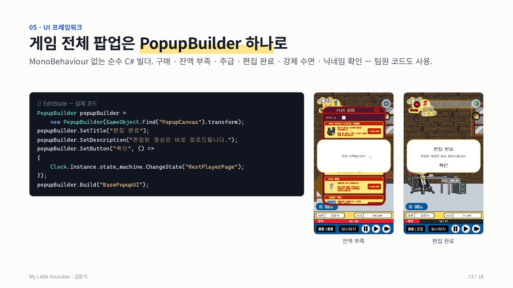](docs/portfolio/page-13.jpg)

[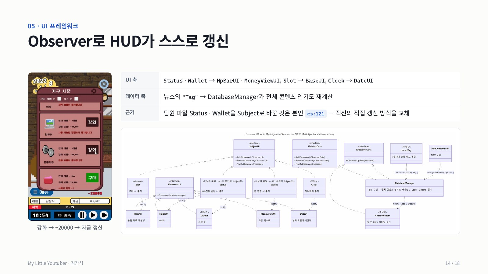](docs/portfolio/page-14.jpg)

[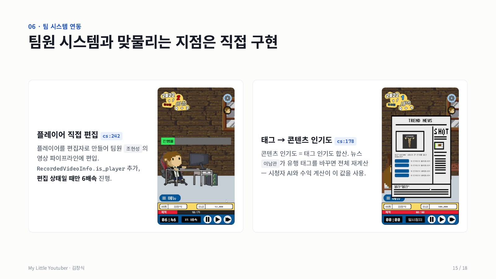](docs/portfolio/page-15.jpg)

[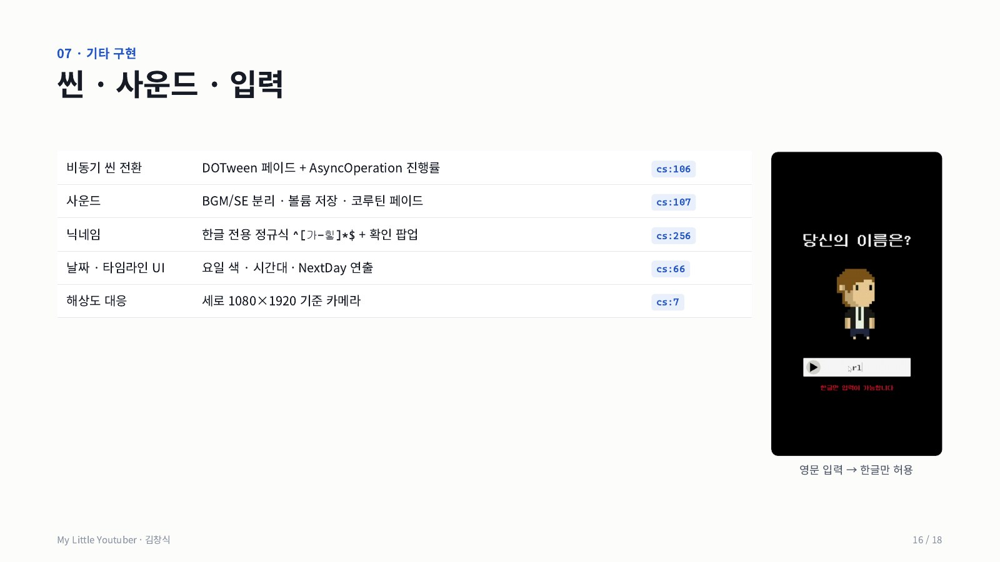](docs/portfolio/page-16.jpg)

[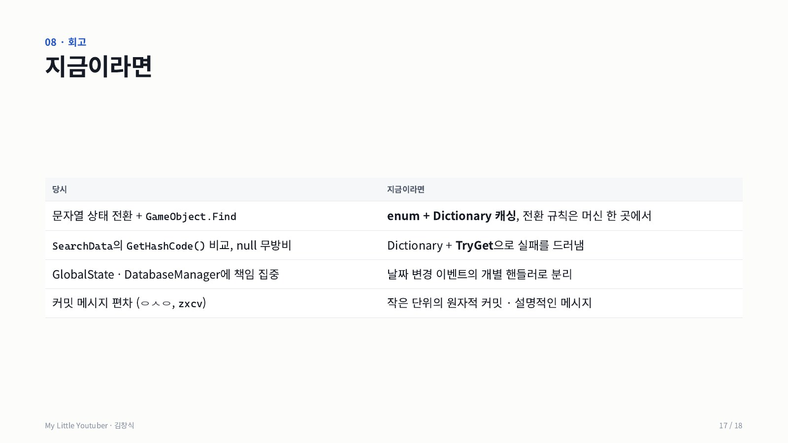](docs/portfolio/page-17.jpg)

[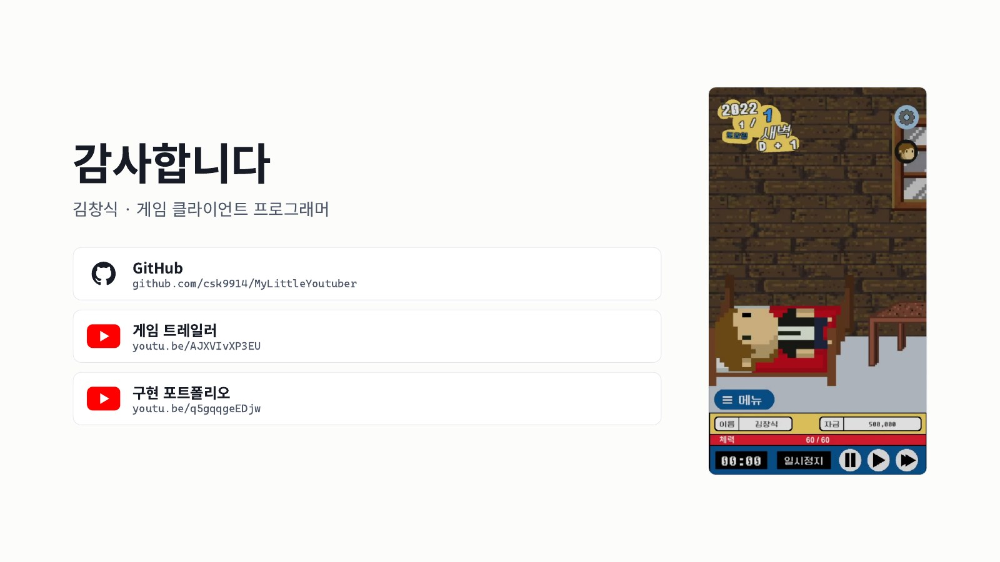](docs/portfolio/page-18.jpg)

## 실행

Unity Hub에서 저장소를 추가하고 Unity 2020.3으로 엽니다. 시작 씬은 `Assets/01.Scenes/TitleScene.unity`입니다.

아트와 사운드는 팀 그래픽 파트의 창작물이며, 저장소는 학습 및 포트폴리오 목적으로 공개되어 있습니다.

