

  <h1>My Little Youtuber · 나작유</h1>
  
하루의 행동을 계획해 나만의 유튜버를 키우는 육성 시뮬레이션

  

    <a href="https://youtu.be/q5gqqgeEDjw">구현 포트폴리오</a> ·
    <a href="https://youtu.be/AJXVIvXP3EU">게임 트레일러</a> ·
    <a href="https://github.com/csk9914/MyLittleYoutuber">GitHub 저장소</a>
  

  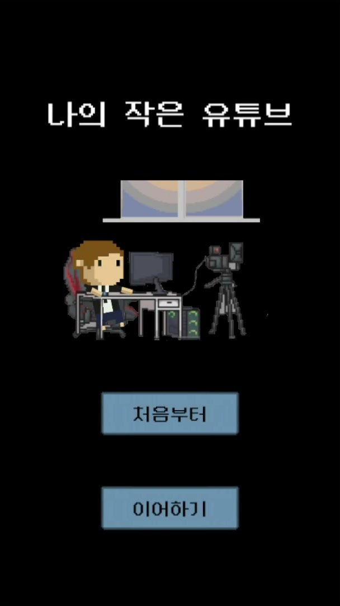
  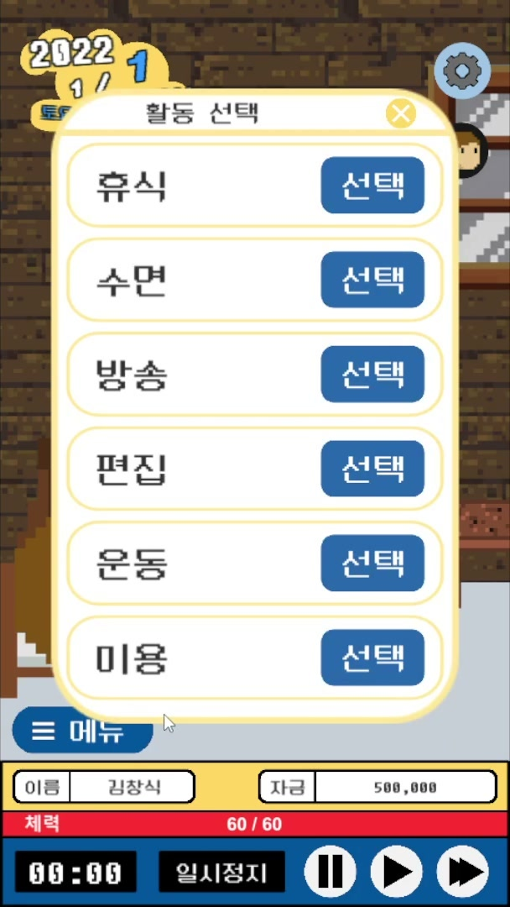
  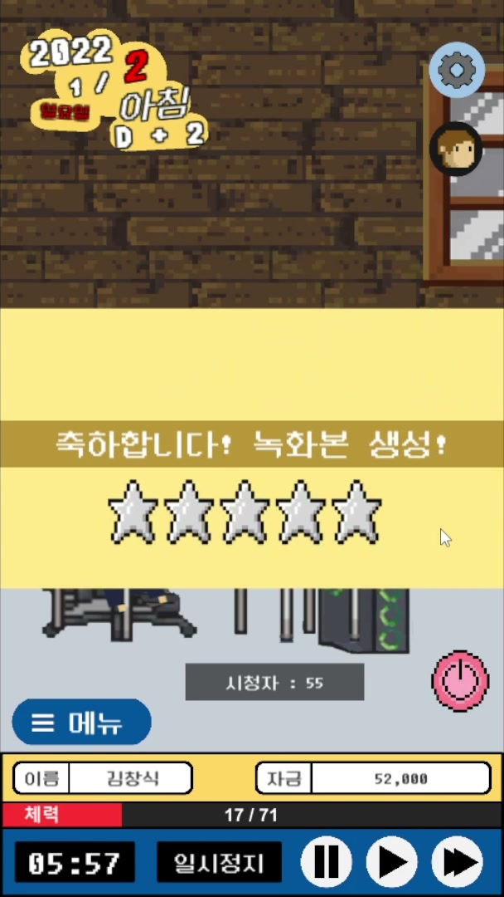

## 프로젝트 개요

방송으로 영상을 만들고, 편집·업로드로 수익과 구독자를 늘려가는 유튜버 육성 시뮬레이션입니다. 하루를 행동 단위로 운영하며 D+365의 구독자 수에 따라 엔딩이 결정됩니다.

| 항목 | 내용 |
|---|---|
| 개발 기간 | 2022.03 – 2022.06 |
| 팀 구성 | 4명 (기획 1명, 프로그래밍 3명) |
| 엔진 / 언어 | Unity 2020.3 / C# |
| 담당 | 게임 시스템 · UI 프레임워크 |

## 담당 역할과 기여

공통 시스템과 UI 기반을 설계하고, 방송·영상 파트의 팀원 시스템이 연결되도록 데이터 흐름과 인터페이스를 구현했습니다.

| Plastic SCM 이력 기준 | 기여 |
|---|---:|
| 전체 261개 커밋 중 담당 커밋 | 144개 (55%) |
| 직접 작성한 스크립트 | 116개 |
| 팀원 담당 코드 통합·수정 | 41개 파일 |

### 확장 가능한 상점 프레임워크

콘텐츠, 가구, 편집자 고용, FLEX 네 상점을 공통 `BaseUI`와 목록·정렬 팩토리로 묶었습니다. enum/switch 분기를 컴포넌트 조립 방식으로 바꿔 새 상점을 추가할 때 기존 상점 코드를 덜 건드리게 했습니다.

| 콘텐츠 | 가구 | 편집자 고용 | FLEX |
|---|---|---|---|
| 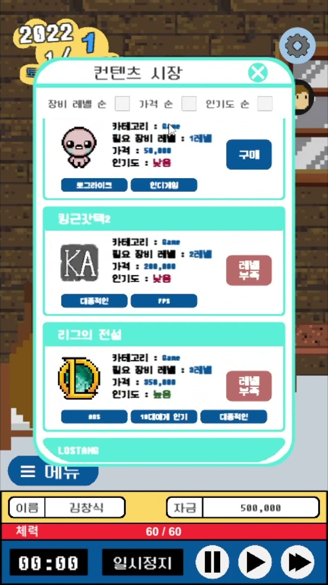 | 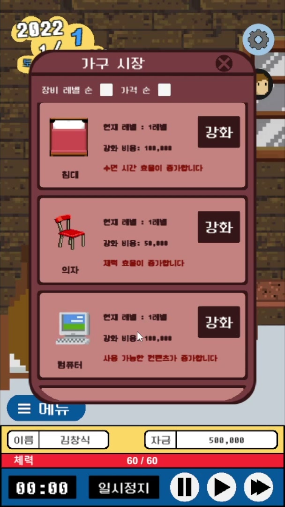 | 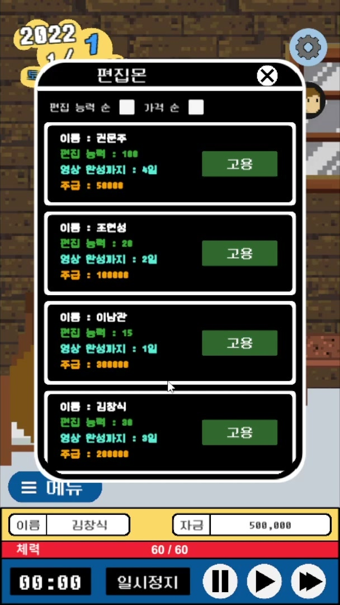 | 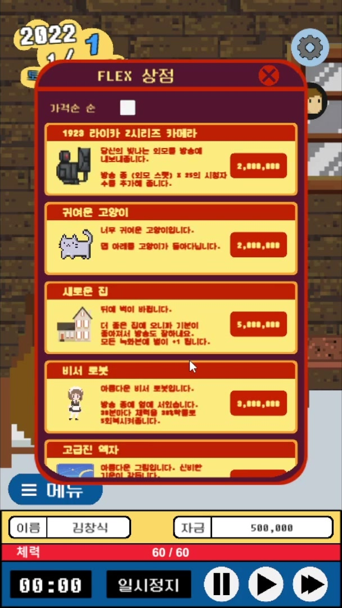 |

**팩토리 구조 변경**

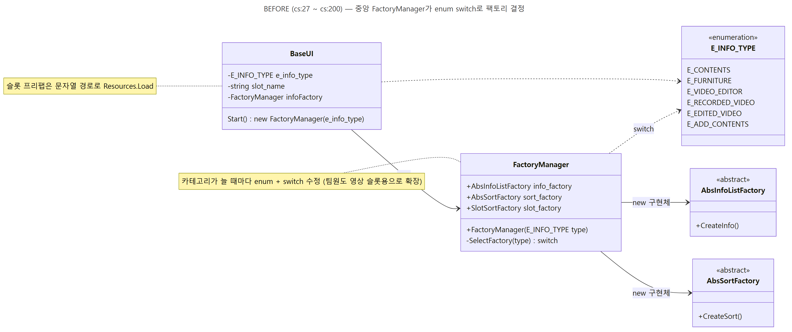

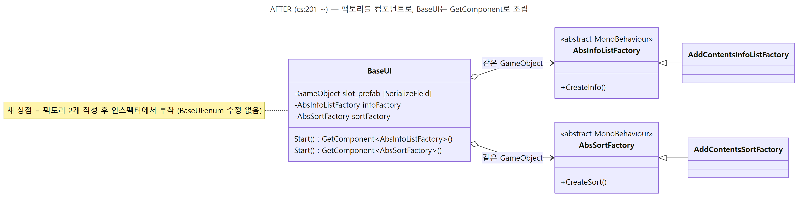

### 행동 상태머신

휴식·수면·방송·편집·미용·운동을 `IState` 구현으로 분리했습니다. 매일 처리되는 날짜, D-day, 소모품, 주급, 엔딩은 항상 동작하는 `GlobalState`가 담당합니다.

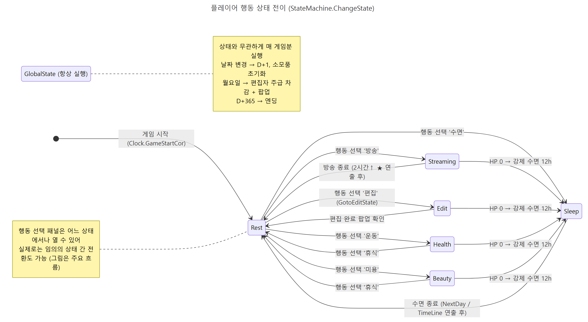

### UI와 데이터 흐름

`PopupBuilder` 하나로 구매·잔액 부족·편집 완료 등의 팝업을 생성하고, Observer 갱신으로 데이터 변경이 HUD와 상점 목록에 전달되도록 했습니다.

| 잔액 부족 팝업 | 편집 완료 팝업 |
|---|---|
| 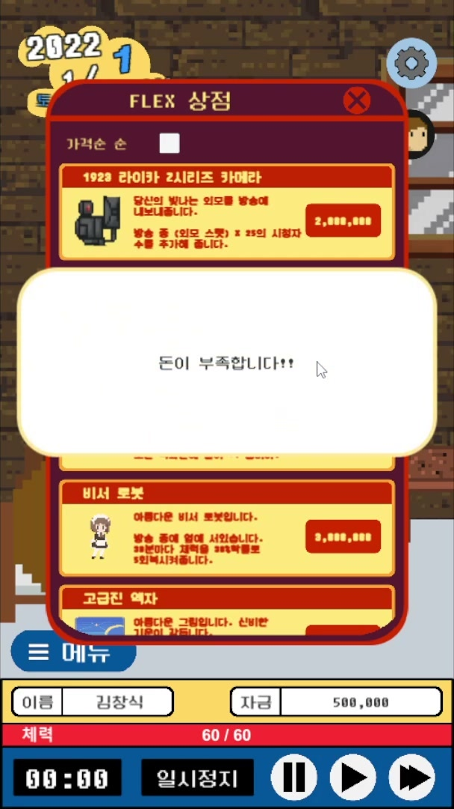 | 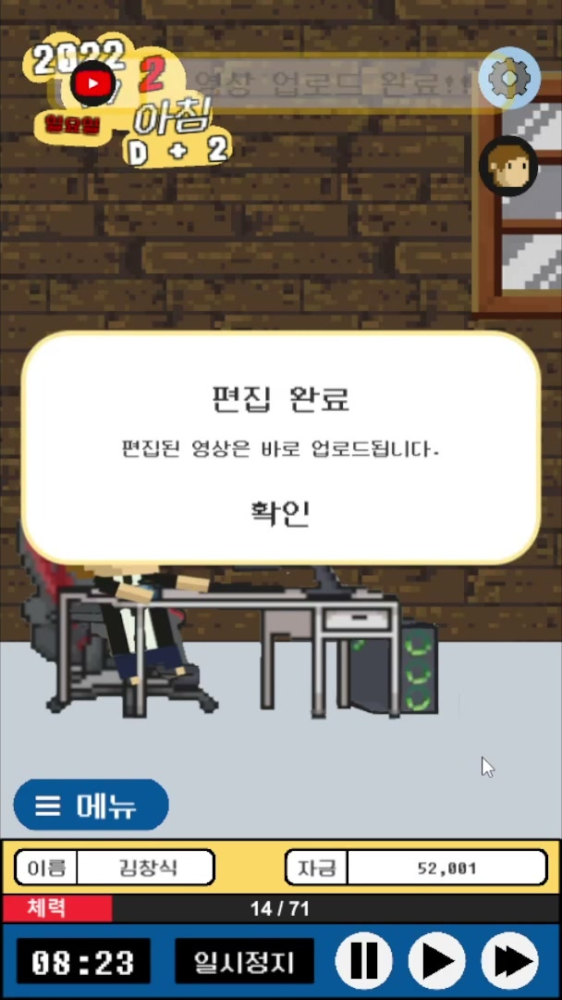 |

기획 값은 프리팹에 두고, 플레이 진행은 CSV에 저장했습니다. 아래는 프리팹에서 가구 효과 데이터를 편집하는 예입니다.

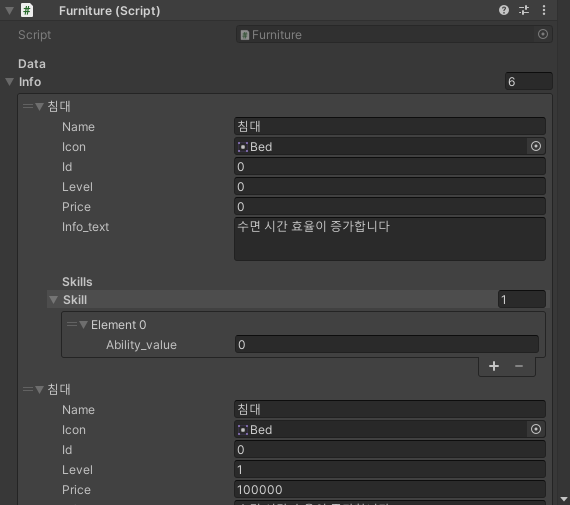

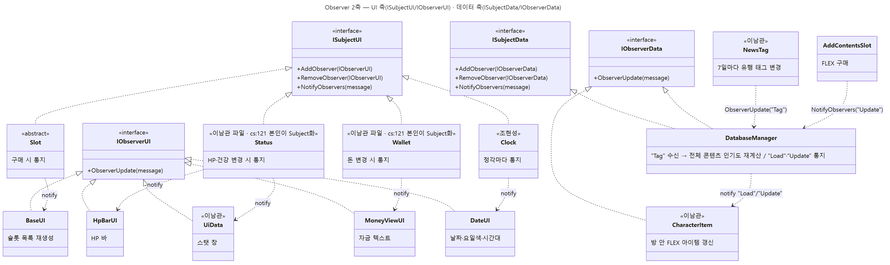

### 팀 시스템 연동

플레이어도 편집자로 영상 편집 파이프라인에 참여하도록 연결했습니다. 뉴스의 유행 태그가 바뀌면 콘텐츠 인기도를 재계산해 시청자와 수익 시스템에 전달합니다.

| 플레이어 영상 편집 | 트렌드 뉴스와 콘텐츠 |
|---|---|
| 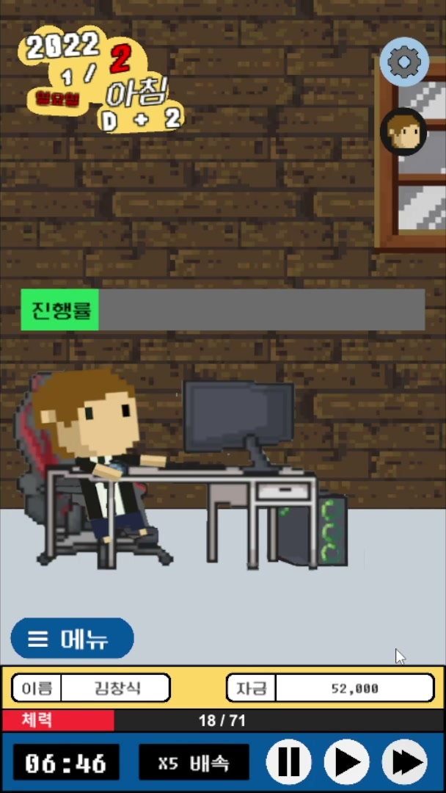 | 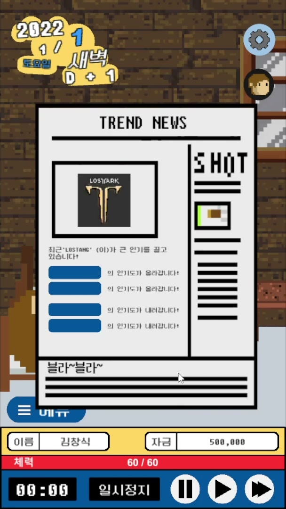 |

## 추가 구현과 회고

- DOTween 페이드와 비동기 씬 전환, BGM/SE 분리와 볼륨 저장, 한글 닉네임 검증, 세로 화면 해상도 대응을 구현했습니다.
- 현재 다시 설계한다면 문자열 상태 이름과 `GameObject.Find` 대신 enum과 캐시를 쓰고, 상태 전환 규칙을 `StateMachine` 한 곳에서 검사하겠습니다.
- `GlobalState`와 `DatabaseManager`에 모인 책임은 날짜 변경 이벤트와 데이터 기능별로 나누겠습니다.

## 실행

Unity Hub에서 저장소를 추가하고 Unity 2020.3으로 엽니다. 시작 씬은 `Assets/01.Scenes/TitleScene.unity`입니다.

아트와 사운드는 팀 그래픽 파트의 창작물이며, 저장소는 학습 및 포트폴리오 목적으로 공개되어 있습니다.

